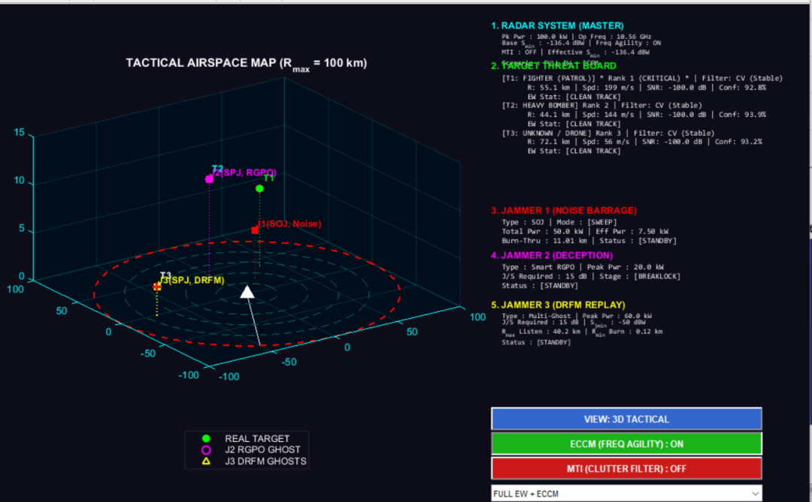
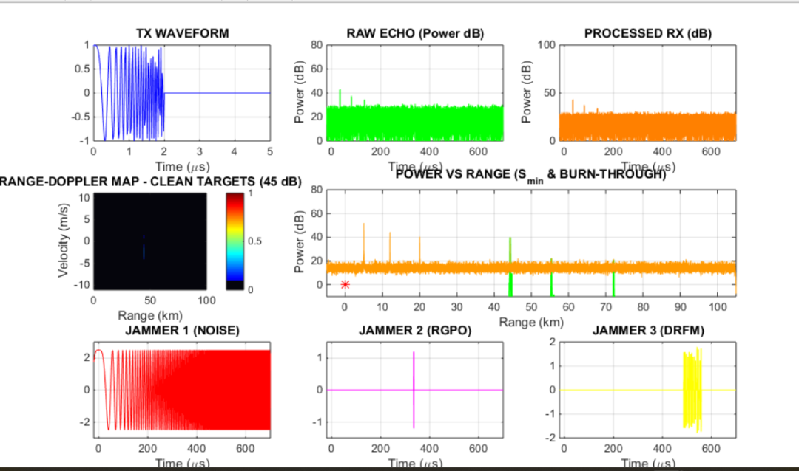
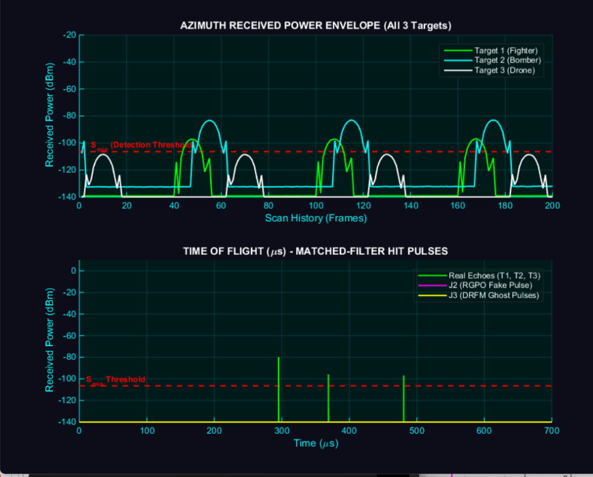
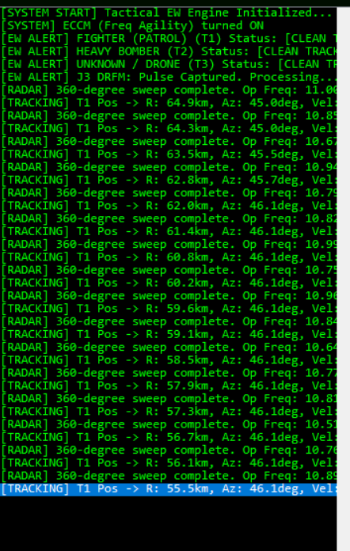
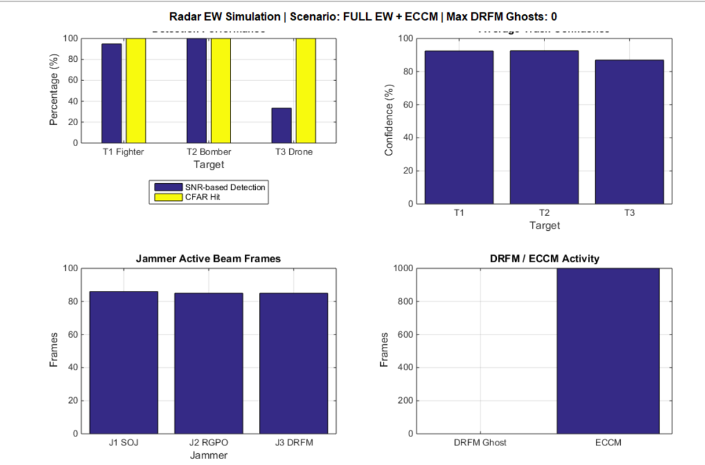

Can targets be seen after radar is "blinded"? A comprehensive understanding of the battle between jamming and anti-jamming in radar electronic warfare. [Includes MATLAB code]

The article discusses the importance of radar electronic warfare simulations, explaining why such simulations are crucial in understanding the invisible electromagnetic battle. The essence of radar is to emit electromagnetic waves into space and then receive the faint energy reflected back by targets. By analyzing time delays, frequency changes, and spatial orientation, it is possible to determine the distance, velocity, and direction of the target. This process may seem simple, but in actual combat scenarios, adversaries will employ various methods to mislead or obstruct radar.
Electronic warfare (EW) consists of two main lines:
1. Electronic attack (EA): This involves using techniques such as noise suppression, deception interference, and decoys to reduce the effectiveness of radar.
2. Electronic protection (EP)/electronic countermeasures (ECCM): This includes designing waveforms, signal processing, frequency management, and polarization technologies to enable radar to function effectively even under interference conditions.
These two lines are not static; they are a continuous evolution of a "cat-and-mouse game." A new type of interference technology emerges, often leading to the development of corresponding anti-interference algorithms within a few years; once these new anti-interference systems are mature, adversaries will develop new deception methods. In this rapid iteration, simulation becomes the critical link—it can repeatedly validate signal processing links, evaluate interference effects, and optimize countermeasure strategies without consuming real equipment or exposing the equipment.
A good radar electronic warfare simulation platform should cover at least the following aspects:
1. Radar system layer: parameters such as transmitter power, operating frequency, waveform parameters, antenna pattern, scanning method, etc.
2.
Target and Environment Layer: Multi-objective motion model, radar cross section (RCS), clutter, noise;
3  
Interference layer: noise interference, distance gate dragging, DRFM forwarding of false targets, etc.
4  
Signal Processing Layer: Matched Filtering, Pulse Compression, Doppler Processing, CFAR Detection, Target Tracking;
5  
Evaluation Layer: Quantifiable metrics such as detection probability, false alarm probability, tracking confidence, and interference suppression ratio.
Only when these five levels are properly modeled can the simulation results have engineering reference value.
II. A Typical Multi-Objective Airspace Scenario: An Example of a Complete Simulation This scenario constructs a single-base radar responsible for monitoring the airspace within a radius of about 100 kilometers. The radar operates in the X-band, with peak emitted power reaching the kilowatt level and possesses frequency agility capabilities. This configuration is quite similar to that of typical air defense surveillance radars or fire control radars.
In the radar field of view, there are three real targets moving simultaneously:
Goal
Type
Threat Level
Main features
T1  
Fighter (patrol status)
High
Fast, RCS is small, and has strong maneuverability.
T2  
Heavy bomber
High
RCS is large, slow, and persistently threatening.
T3  
Drone
Chinese
RCS is extremely small, slow, and difficult to stably detect.
These three objectives differ in distance, speed, and orientation, covering the typical difficulties of radar detection, such as "big targets are easy to see, small targets are difficult to stabilize."
At the same time, the enemy has set up three interference sources corresponding to three mainstream interference styles:
Interference source
Type
Mechanism
J1  
Noise suppression interference (SOJ)
Inject high-power noise into the radar receiver to raise the base noise level and reduce the radar detection range.
J2  
Distance from door pulley (RGPO)
After intercepting radar signals, gradually create increasingly delayed pseudo-echoes to lure the radar into tracking a pseudo target.
J3  
DRFM forwarding fake target
High-speed sampling and delayed forwarding of radar signals to generate multiple "ghost targets" on the screen.
The design concept of this scene is very clear: it is not to simply add interference, but let each type of interference represent a kind of real threat, so as to test the robustness of radar signal processing link.
III. Three Major Typical Interference Methods: From "Noise Overwhelm" to "Phantom Aircraft Swarms" 3.1 Noise suppression interference: making radar "deaf and blind" Noise interference is the oldest and most direct method of radar interference. Its principle is simple: an interference machine sends high-power noise signals towards the radar receiver, elevating the receiver's baseline noise. The target echo power remains unchanged, but the background noise increases, leading to a sharp decrease in the radar signal-to-noise ratio (SNR), resulting in reduced detection range and decreased detection probability.
From the perspective of radar equations, the detection range of a radar towards a target is directly related to the received signal-to-noise ratio. When the interference power is sufficient, the effective detection range of the radar can be compressed to one-fifth of its original value, a phenomenon known in electronic warfare as "burn-through range" (Burn-through Range). Only when the target is sufficiently close can the echo power overcome the interference power again.
3.2 Range Gate Pull-Off (RGPO): If noise interference is a "hard fight," then Range Gate Pull-Off (RGPO) is a "smart battle."
When radar tracks a target, it opens a very narrow "distance gate" near the target's distance. Only echoes within the gate are finely processed to improve signal-to-noise ratio and tracking accuracy. RGPO precisely leverages this mechanism:
1  
Capture phase: The jammer receives the radar signal and immediately forwards a pseudo echo that coincides in height with the real target echo, allowing the radar's range gate to lock onto this pseudo echo.
2  
Dragging phase: The jammer gradually increases the forwarding delay, making the false echoes appear increasingly far away.
3  
Release phase: When the pseudo-echo is dragged far enough and the radar tracking loop completely "loses" the real target, the jammer shuts down its forwarding function, leaving only noise within the radar's range gate, and the real target has already slipped away.
RGPO poses a particularly significant threat to pulse-tracking radars and semi-active guidance radars because it directly attacks the radar's tracking loop. The key to countering RGPO lies in recognizing the anomalous changes in echo characteristics, such as sudden strong echoes, distance change rates that do not conform to the target dynamics constraints, and Doppler shifts that do not match the distance.
3.3 DRFM forwarded pseudo-targets: Creating "ghost aircraft" digital radio frequency memory (DRFM) is one of the core components of modern electronic warfare systems. It can sample radar transmission signals with high precision, store them in the digital domain, and then modulate, delay, and Doppler shift them before forwarding them out.
Compared to traditional noise interference, the advantages of DRFM are:
Coherent: The forwarded pseudo-target matches the radar waveform, can smoothly pass through the matching filter, and has a higher energy utilization efficiency than noise;
Controllable: It can precisely control delays and Doppler shifts, creating pseudo-echoes with similar distance and velocity to the real target;
Batch generation: Through digital replication, it is possible to create dozens or even hundreds of pseudo-targets at different distances, forming a "ghost fleet."
For fire control radars or air defense systems, the threat of DRFM pseudo-targets lies in: they occupy a large amount of tracking resources, making it impossible for the system to distinguish between which target is real, and may even induce missile attacks on false targets. In this simulation, the DRFM jamming source successfully introduced multiple ghost echoes into the radar screen, significantly increasing the burden on the signal processing end.
How does a radar "counteract" interference? From matching filters to ECM facing the above three types of interference, a radar is not helpless. Modern radar's ability to resist interference spans every aspect of waveform design, antenna technology, signal processing, and data processing.
4.1 Matched Filtering: The first step in radar signal processing is to "fish out" the target from noise by matched filtering. Its core idea is to design a filter that matches the transmitted waveform, allowing the echo of real targets to gain the maximum signal-to-noise ratio (SNR) gain after filtering. For linear frequency modulation (LFM) pulses, matched filtering is equivalent to pulse compression, which can compress the energy of wide pulses into narrow pulses while significantly improving range resolution.
Under weak noise interference, matched filtering can "fish out" the target echo buried in noise; however, under strong noise suppression, the output noise floor of matched filtering will also be raised, and further improvement in SNR is still needed.
4.2 Doppler Processing: Using velocity to distinguish between real and false targets, doppler processing is another powerful tool in modern radar. The Doppler shift caused by the relative motion of the target with respect to the radar can be distinguished from the Doppler shift of stationary clutter and some interference signals. By using methods such as Fast Fourier Transform (FFT), the radar can expand the received signal on the "range-Doppler" two-dimensional plane, forming a Range-Doppler Map.
On the Range-Doppler Map, true targets usually appear as a clear energy focus, while noise interference appears as a large area of diffuse energy. Although DRFM false targets can also be modulated with Doppler shifts, their movement characteristics often differ from those of real targets, providing clues for further discrimination.
4.3 CFAR Detection: Adaptive Thresholding to Reduce False Alarms - Constant False Alarm Rate (CFAR) detection is the core algorithm for radar target detection. Its basic idea is to dynamically adjust the detection threshold based on the average noise/clutter power around the detection unit, thus maintaining a stable false alarm probability in complex backgrounds.
In scenarios with interference, CFAR becomes particularly important. Without adaptive thresholds, fluctuations in interference power can lead to a significant number of false alarms; however, CFAR allows the threshold to "follow the background," thereby reducing the number of false detections to some extent. Nonetheless, CFAR is not foolproof—its performance can degrade if interference power fluctuates sharply within a local reference window or if multiple false targets are densely distributed.
4.4 Electronic Combat (ECCM): Frequency Switching and Interference Rejection
Frequency hopping combined with matching filtering, Doppler processing, and CFAR detection forms a complete anti-interference link. Its effectiveness can be intuitively seen through the final DRFM ghost statistics: after enabling ECCM, the number of DRFM ghost frames and maximum ghost count are both suppressed to zero, allowing the radar to regain stable tracking of real targets.
V. Simulation Results: Amazing Contrast Before and After the Combat
Goal
Type
SNR detection rate
CFAR hit rate
Average tracking confidence
T1  
Fighter jet
94.87%  
100%  
92.49%  
T2  
Bomber
100%  
100%  
92.59%  
T3  
Drone
33.33%  
100%  
86.99%  
This set of data is very interesting and worth us to read it line by line:
The T2 bomber performed best, being consistently detected and tracked throughout the mission. This aligns with physical intuition: bombers have large radar cross-section (RCS), resulting in strong echo energy, making them easily detectable by radar even in interference environments.
The SNR detection rate of T1 fighter jets is close to 95%, and the CFAR hit rate reaches 100%. This indicates that although the fighter jet has a small radar cross section (RCS), its high speed and distinct Doppler characteristics allow it to be reliably identified with the help of Doppler processing and CFAR.
The CFAR hit rate of T3 drones reaches 100%, but the SNR detection rate is only 33.33%. This suggests that the radar can find suspected echoes in each scanning cycle, but due to the extremely low RCS and faint echoes of the drone, many frames are overwhelmed by noise, failing to establish a stable continuous track. This metric also reminds engineers: for "low, slow, and small" targets, relying solely on traditional radar systems is insufficient; it is necessary to combine phase-coherent accumulation, MIMO, and multi-radar network technologies.
Looking at the effectiveness of ECCM:
ECCM is effectively activated;
DRFM ghost frame count: 0;
Maximum DRFM ghost count: 0.
This means that after enabling frequency jittering and other anti-interference measures, the ghost targets created by DRFM are completely suppressed, and the radar's tracking resources are refocused on three real targets. Although this result is not guaranteed in actual combat scenarios, it clearly demonstrates the design value of ECCM in simulation.
From simulation to engineering: What can we learn? 6.1 Simulation is not just "playing around," but the first step in algorithm verification. Many people misunderstand simulation as "looking good on paper." A rigorous radar electronic warfare simulation platform can help engineers complete the following tasks before investing in hardware:
Verify the correctness of waveform design and signal processing algorithms;
Quantify the performance boundaries under different interference conditions;
Optimize the trigger threshold and parameter configuration of ECCM strategies;
Provide basis for system metrics decomposition.
Detection probability and false alarm probability;
Track continuity and confidence level;
Performance degradation before and after anti-interference activation;
Effect of target type, RCS, and velocity on results.
6.3 The game of interference and counter-interference is endless. DRFM is suppressed by frequency jitter, and in the future, cognitive electronic interference may emerge, capable of real-time perception of radar hopping patterns; radars may adopt more random waveforms, distributed networking, and artificial intelligence-assisted target discrimination. This game has no end, and simulation is key to shortening the innovation cycle.
Conclusion: In the "seeing" and "being seen" of electromagnetic fog, the essence of radar electronic warfare is a battle over "information." The interferer attempts to drown out true information with noise, deception, and decoy targets; the radar side rediscovers true targets through waveforms, algorithms, and countermeasures amidst the electromagnetic fog.
The simulation project introduced in this article, despite being a simplified model at an academic level, fully represents the entire chain from radar transmission, target echo, interference injection, signal processing to target detection and tracking. More importantly, it uses a set of quantifiable indicators to tell us that interference indeed weakens radar, but a reasonable ECCM design can allow radar to maintain stable tracking of true targets even under strong interference.
For colleagues engaged in radar, electronic warfare, and communication countermeasures, such a simulation platform is not only a learning tool but also a nest for algorithm incubation. In the future, as concepts like cognitive radar, intelligent interference, and software-defined electronic warfare mature, the importance of simulation in the field of radar electronic warfare will only increase.
Finally, I pose a question to the readers: In your view, what are the biggest breakthroughs in radar anti-interference technology in the next decade? Will it be waveform design, antenna technology, or multi-platform collaboration? Please share your opinions in the comments section.

## Images

<!-- PAYMENT_BLOCK -->

## Get this dataset

- Payment link (Stripe): [Buy now](https://buy.stripe.com/3cs8yP7sY87d0vu9AB)
- Payment QR code: 

<!-- /PAYMENT_BLOCK -->
